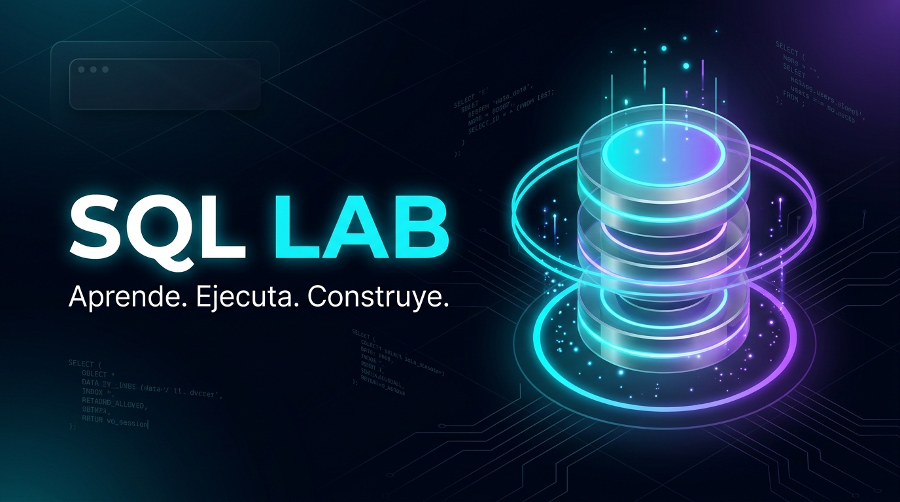
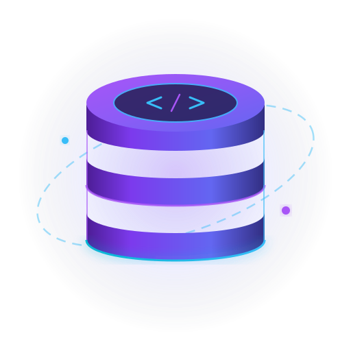

<p align="center">
  
</p>

<p align="center">
  
</p>

<h1 align="center">SQL LAB</h1>
<p align="center"><strong>Aprende. Ejecuta. Construye.</strong></p>

<p align="center">
  <em>Laboratorio interactivo de bases de datos relacionales PostgreSQL que funciona 100% en el navegador del usuario mediante WebAssembly e IndexedDB.</em>
</p>

<p align="center">
  <a href="#-demostración-en-vivo"></a>
  <a href="#-arquitectura-tecnológica"></a>
  <a href="#-arquitectura-tecnológica"></a>
  <a href="#-arquitectura-tecnológica"></a>
  <a href="#-arquitectura-tecnológica"></a>
</p>

---

## 📖 Descripción General

**SQL LAB** es un entorno integrado de desarrollo (IDE) y academia interactiva concebido para aprender, experimentar y diseñar bases de datos SQL profesionales directamente desde cualquier navegador web.

A diferencia de los entornos tradicionales que requieren complejas instalaciones de servidores locales (PostgreSQL, Docker) o suscripciones en la nube, **SQL LAB ejecuta una instancia real de PostgreSQL 16 compilada a WebAssembly (PGlite)**. Todo el almacenamiento se persiste localmente en **IndexedDB**, garantizando que tus tablas, consultas, registros y proyectos nunca salgan de tu equipo.

---

## ✨ Características Principales

- ⚡ **Motor PostgreSQL Nativo (PGlite Wasm)**: Cero datos simulados. Ejecuta DDL, DML, DQL, TCL, CTEs (`WITH`), funciones de ventana, transacciones ACID y subconsultas complejas.
- 💾 **Persistencia Local en IndexedDB**: Tus bases de datos se guardan de forma permanente en tu navegador y sobreviven al cierre de pestañas y reinicios del equipo.
- 🛡️ **Snapshots Preventivos Automáticos**: Antes de sentencias destructivas (`DROP TABLE`, `TRUNCATE`, `DROP DATABASE`), el sistema crea una copia de seguridad recuperable en 1 clic.
- 📊 **Visualización Automática de Tablas (Prioritaria)**: Al escribir `CREATE TABLE` o modificar esquemas, el explorador lateral, la tarjeta visual, las claves primarias (🔑), foráneas (🔗) y el diagrama ER se actualizan inmediatamente en tiempo real.
- 🎨 **Diagrama Entidad-Relación Interactivo**: Lienzo con cuadrícula estilo blueprint, tarjetas de tablas arrastrables (*Drag & Drop*) y curvas Bezier con cardinalidad `1` y `N`.
- 💻 **Terminal SQL Xterm.js**: Terminal estilo `psql` con salida en tablas ASCII, comandos internos (`help`, `clear`, `history`, `databases`, `tables`, `describe`, `\c`, `version`).
- 📝 **Monaco Editor Integrado**: Resaltado de sintaxis PostgreSQL, atajos de teclado (`F5`, `Ctrl+S`, `Ctrl+Shift+F`), formateador automático y autocompletado inteligente de tablas y columnas.
- 📑 **Visualizador de Datos Tipo Hoja de Cálculo**: Ordenamiento por columnas, filtros en vivo, paginación, edición inline de celdas con guardado directo vía `UPDATE`, y exportación a **CSV** y **JSON**.
- 🎓 **Academia Interactiva (12 Lecciones)**: Explicaciones teóricas con código SQL ejecutable al instante y seguimiento de progreso.
- 🏆 **Modo de Desafíos**: Retos evaluados automáticamente contra el motor PostgreSQL con pistas pedagógicas y explicaciones.
- 🗄️ **8 Bases de Datos de Ejemplo**: Tienda Online, Sistema Bancario, Biblioteca, Universidad, Hospital, Empleados, Restaurante y Red Social preconfiguradas con datos reales y relaciones.

---

## ⌨️ Atajos de Teclado del Editor

| Atajo | Acción |
| :--- | :--- |
| `F5` / `Ctrl + Enter` | Ejecutar consulta SQL o texto seleccionado |
| `Ctrl + S` | Guardar archivo / pestaña activa en IndexedDB |
| `Ctrl + Shift + F` | Formatear código SQL automáticamente |
| `Ctrl + Space` | Desplegar autocompletado inteligente |

---

## 🛠️ Tecnologías Utilizadas

- **Framework**: [Angular](https://angular.dev/) (Standalone Components, Signals, Zoneless reactive architecture)
- **Motor SQL Wasm**: [@electric-sql/pglite](https://pglite.dev/) (PostgreSQL 16 en WebAssembly)
- **Persistencia**: IndexedDB API (`idb://` driver nativo)
- **Editor de Código**: [Monaco Editor](https://microsoft.github.io/monaco-editor/)
- **Terminal Web**: [@xterm/xterm](https://xtermjs.org/)
- **Estilos**: [Tailwind CSS v4](https://tailwindcss.com/)
- **Iconografía**: [Lucide](https://lucide.dev/)
- **Test Runner**: [Vitest](https://vitest.dev/)

---

## 🚀 Inicio Rápido en Desarrollo

```bash
# Clonar o entrar al repositorio
cd SQLAB

# Instalar dependencias
npm install --legacy-peer-deps

# Iniciar servidor de desarrollo
npm start
```

Abre tu navegador en [http://localhost:4200/](http://localhost:4200/).

---

## 📦 Compilación para Producción

Para compilar la aplicación estática optimizada para producción (lista para desplegar en GitHub Pages, Cloudflare Pages, Vercel, Netlify o cualquier servidor estático):

```bash
npm run build
```

Los archivos de distribución quedarán generados en la carpeta `dist/sqllab/browser/`.

---

## 🧪 Pruebas Automatizadas

```bash
npm test -- --watch=false
```

---

## 📄 Licencia

Este proyecto está bajo la Licencia MIT. Consulta el archivo `LICENSE` para más detalles.
